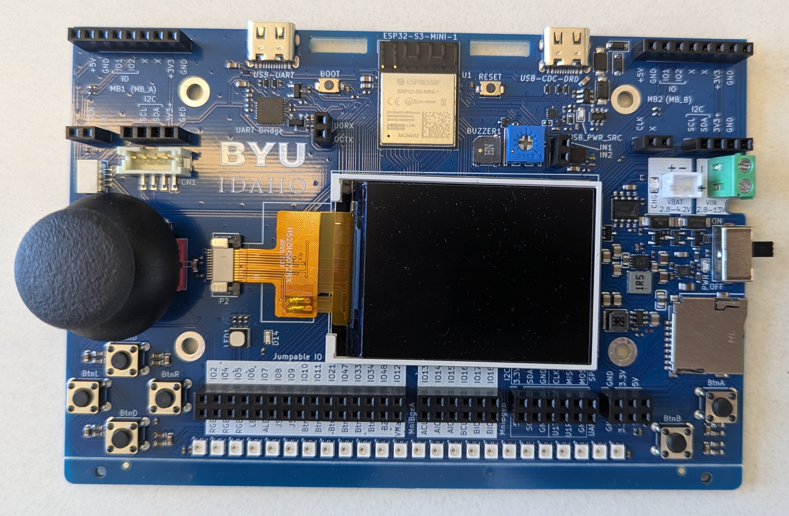
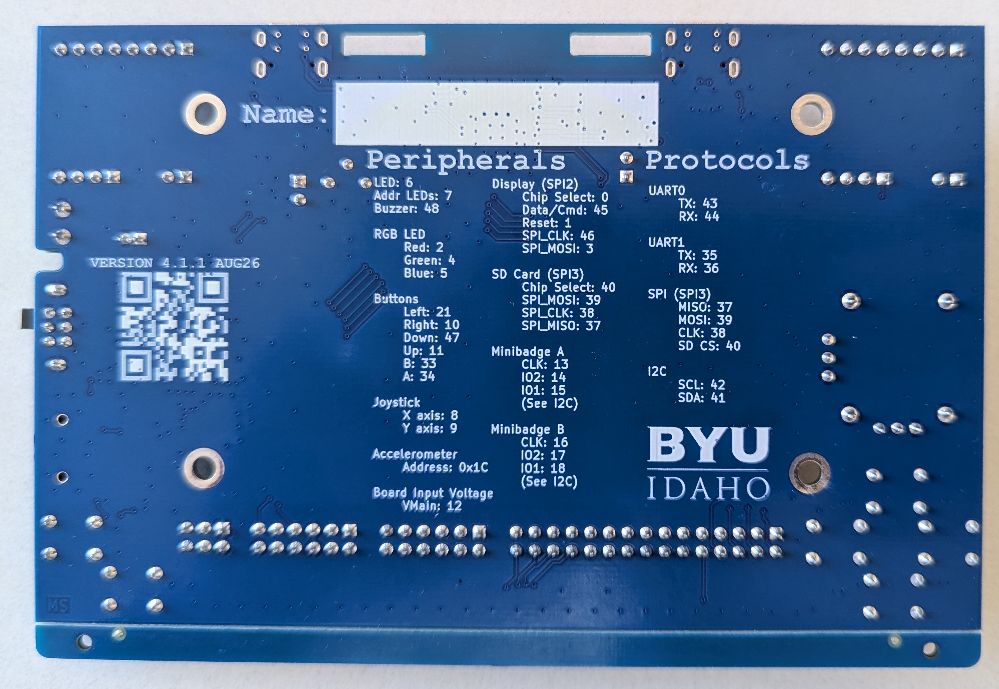

# pybadge

`pybadge` is a beginner-friendly Python interface for BYU-Idaho's ESP32-S3
eBadge. The goal is for any user to write ordinary Python programs that use
buttons, LEDs, the screen, sound, sensors, and Wi-Fi without dealing with GPIO
numbers or low-level electronics APIs.

The `pybadge.py` interface supports three modes: the physical eBadge, an
interactive terminal simulator, and a headless test backend. The public API
has been reviewed; remaining work is tracked in [TODO.md](TODO.md) and the
[specifications](specifications/). Programs in [`examples/`](examples/) show
the intended user experience. The simulator keeps the BYU-Idaho logo as
permanent blue-board artwork, separate from the simulated screen controlled
by the running program.

## Using and sharing this project

Use this repository as the maintained source for the library, examples, and
setup instructions. Keep personal programs under `examples/` or a clearly
named work folder; normal use should not require editing library internals.
Users can fork or clone the repository when GitHub access is available. For
restricted or offline environments, distribute a ZIP or prepared checkout.
After the initial copy, programs can be developed without network access.

Record a known repository revision when reproducibility matters. Keep personal
programs and generated files separate from maintained library changes. The API
is still under implementation, so this project does not currently require a
pip package. Once the API is stable, a versioned host-side package may be an
additional simulator installation option; badge deployment will still require
copying MicroPython-compatible files to the device. See the
[user workflow recommendation](specifications/user-workflow.md) for the
distribution tradeoffs.

The API includes accelerometer and battery-voltage helpers. Battery readings
are voltages, not estimated charge percentages; the physical battery reading
uses a nominal divider ratio and still needs calibration. Normalized joystick
directions are available in the simulator and test backend, while hardware
support remains disabled until its direction and center behavior are
calibrated. BLE and SD-card support are deferred future work.

The terminal simulator models buttons, joystick positions, the screen, LEDs,
and buzzer activity. It does not model Wi-Fi scanning, accelerometer or
battery readings, external GPIO, voltage measurement, or PWM output. It is not
a full electrical simulation.

## Board photographs

These V4.1.1 photos show the current target board. The front shows the controls
and components; the back includes a printed quick reference for GPIOs and buses.





## Repository structure

| Path | Purpose |
| --- | --- |
| `pybadge.py` | User-facing API shared by all runtime modes. |
| `backends/` | Hardware, simulator, and headless test implementations. The maintained `backends/hardware/` package contains the on-device drivers. |
| `board/` | eBadge Git submodule and hardware design source (initialize with the submodule command below). |
| `specifications/` | Python standards and the current V4.1.1 board specification. |
| `examples/` | Small programs demonstrating the public API. |
| `old/python/` | Archived course samples and hardware libraries. These are reference examples and do not follow this project's Python standards. |
| `hardware/ebadge/` | eBadge setup guide and reference material. |
| `resize_image.py` | Host utility that prepares 24-bit BMP files for the badge display. |
| `byui-cse.png` | Logo asset used by the display example. |
| `byui-cse_badge.bmp` | Prepared 320 × 115 logo image used by the display example. |

The current board target is V4.1.1. The hardware specification compares the
V4 course software with the V4.1.1 design files, production netlist, and board
photos. Firmware-dependent behavior and ADC calibration are called out where
they still need validation on physical hardware.

### Board labels, GPIO numbers, and jumper bridges

The board silkscreen uses labels such as `IO13`; these identify the same signal
as ESP32 `GPIO13`. They are GPIO numbers, not physical lead numbers on the
ESP32 module. Code and pin helper functions use the ESP32 GPIO number. For
example, board label `IO13` corresponds to GPIO value `13`.

The board has removable jumper bridges that connect onboard devices and
headers to GPIO signals. The board specification and built-in peripheral
helpers describe the standard, as-built bridge positions. Removing or moving a
bridge changes the electrical routing: a built-in device may no longer be
connected to the GPIO its helper expects, and a GPIO may become available for
an external circuit. The software cannot detect a manually changed bridge.
Built-in peripheral helpers support the standard routing only. If a bridge is
changed, record the new route and use `configure_pin()` / `read_pin()` /
`write_pin()` / `set_pwm()` with the GPIO signal actually connected; restore
the standard bridge positions before using the built-in peripheral helper
again. The current API does not let users remap a built-in peripheral helper.

The V4.1.1 upstream production netlist confirms GPIO13–GPIO18 are routed to
J9's odd-numbered contacts (1, 3, 5, 7, 9, and 11). The upstream BOM's U1
description says `ESP32-S2-MINI-1`, while its manufacturer part number and the
design files identify an ESP32-S3-MINI-1-N4R2. Use the GPIO signal names in
software; do not infer module pad numbers from that inconsistent description.

The `set_pwm(pin, frequency_hz, duty_percent)` helper uses a duty
percentage from 0 to 100. A duty of `0` keeps the output off; `100` keeps it
on. For example, this requests a 1,000 Hz signal that is on half of each cycle:

```python
pybadge.set_pwm(pybadge.GPIO13, frequency_hz=1000, duty_percent=50)
```

The small RGB LED and the addressable LED strip have separate names. The
agreed API uses `set_rgb_led(color)` for the small indicator and
`set_led_strip_pixel(index, color)`, `set_led_strip(colors)`, and
`clear_led_strip()` for the 24-pixel strip. For an animation, a program can
update a whole frame in a loop and control the frame delay itself:

```python
pybadge.set_led_strip(frame_colors)
pybadge.pause(80)  # wait 80 milliseconds before the next frame
```

Frame updates and timing are separate; animations do not require a predefined
animation or a timing list.

The display API also includes `draw_pixel()`, `draw_line()`, and
`draw_rectangle()`. A rectangle can be outlined or filled with `filled=True`.
The simulator records these drawing operations and their coordinates in its
screen area; it does not rasterize them into a graphical image.

The upstream eBadge source is tracked as a Git submodule. Initialize it after a
fresh checkout with:

```sh
git submodule update --init --recursive
```

The V4.1.1 KiCad design is in
[`board/hardware v4.1.1/badge-esp32-s3/`](<board/hardware v4.1.1/badge-esp32-s3/>).

## Set up MicroPython on the eBadge

The badge uses an ESP32-S3. Connect the computer to the badge's USB-C port
labeled **USB-UART** with a data-capable cable. Install the host tools:

```sh
python -m pip install esptool mpremote
```

Find the serial port assigned to the badge:

- **Windows:** a port such as `COM3` in Device Manager under **Ports (COM & LPT)**.
- **macOS:** usually `/dev/cu.usbmodem...` or `/dev/cu.usbserial...`.
- **Linux:** usually `/dev/ttyACM0` or `/dev/ttyUSB0`; your account may need serial-device permissions.

Download a MicroPython firmware build for a generic ESP32-S3 from the
[MicroPython ESP32-S3 downloads](https://micropython.org/download/ESP32_GENERIC_S3/).
The course setup guide refers to `ESP32_GENERIC_S3-20260824-v1.29.0.bin`, but
that binary is not currently present in this checkout. Use the filename of the
firmware image you downloaded in the command below.

Erase the badge flash and install the firmware (replace `<PORT>` and the image
filename with the values for your computer):

```sh
python -m esptool --port <PORT> erase_flash
python -m esptool --port <PORT> --baud 460800 write_flash 0 ESP32_GENERIC_S3-20260824-v1.29.0.bin
```

If the board does not enter download mode, hold **BOOT** while starting the
flash operation, then release it once flashing begins. Check the installed
`esptool` help if its command syntax differs from these course-guide commands.

Open the MicroPython REPL (interactive prompt):

```sh
python -m mpremote connect <PORT>
```

At the `>>>` prompt, try `print("Hello from the eBadge!")`. Press **Ctrl-]** to
leave the REPL. If port auto-detection works, `python -m mpremote` can connect
without an explicit port.

## Run the headless tests

The pytest suite uses the deterministic test backend. It does not launch the
terminal simulator or require an eBadge:

```sh
python -m pip install pytest
python -m pytest
```

GitHub Actions runs this suite automatically on every push and pull request.
The tests are collected only from `tests/`; archived examples under `old/` are
reference material, not pytest test modules.

The headless suite also checks deterministic accelerometer and voltage values.
It cannot validate the physical sensors or ADC calibration.

## Run the terminal simulator

Install Textual. Pillow is optional and enables the permanent logo artwork;
the simulator shows a text fallback when Pillow or image rendering is
unavailable:

```sh
python -m pip install textual pillow
```

From the repository root, run a program that calls `pybadge.initialize()`.
For example, on macOS or Linux:

```sh
PYTHONPATH=. python examples/01_button_led.py
```

In PowerShell, use `$env:PYTHONPATH = "."` before running the same Python
script. The clickable D-pad and A/B buttons model physical buttons; the
separate joystick pad sets normalized joystick positions until centered again.
The screen, RGB indicator, 24 strip LEDs, and buzzer state are shown in the
terminal board. Press `q` to close the board and **Ctrl-C** to stop a running
example program.

## Run the examples

The programs in [`examples/`](examples/) demonstrate the intended API:

1. Light the RGB LED while button A is held.
2. Scan for and list nearby Wi-Fi networks.
3. Play a tone when button A is pressed.
4. Display the BYU-Idaho CSE logo from `byui-cse.png`.
5. Draw pixels, lines, and outlined and filled rectangles.

These programs use `pybadge.py`. Some physical hardware behavior still needs
validation; see [TODO.md](TODO.md) for remaining work and hardware limitations.
Before running the logo example, prepare the PNG for the display with the
host utility. Install Pillow if it is not already available:

```sh
python -m pip install pillow
python resize_image.py byui-cse.png
```

This creates `byui-cse_badge.bmp`, an uncompressed 24-bit BMP resized to fit
the 320 × 240 display while preserving the source aspect ratio. Small source
images are not enlarged.

### Copy project files to the badge

Hardware mode uses the maintained backend and driver modules in this
repository. It does not require files from `old/python/`. From the repository
root, create the backend directories and copy the required modules. Replace
`<PORT>` with the badge's serial port:

```sh
python -m mpremote connect <PORT> fs cp pybadge.py :pybadge.py
# Create each directory once; skip a mkdir command if that directory exists.
python -m mpremote connect <PORT> fs mkdir :backends
python -m mpremote connect <PORT> fs cp backends/__init__.py :backends/__init__.py
python -m mpremote connect <PORT> fs cp backends/hardware_backend.py :backends/hardware_backend.py
python -m mpremote connect <PORT> fs mkdir :backends/hardware
python -m mpremote connect <PORT> fs cp backends/hardware/__init__.py :backends/hardware/__init__.py
python -m mpremote connect <PORT> fs cp backends/hardware/st7789py.py :backends/hardware/st7789py.py
python -m mpremote connect <PORT> fs cp backends/hardware/vga1_8x16.py :backends/hardware/vga1_8x16.py
python -m mpremote connect <PORT> fs cp examples/01_button_led.py :main.py
```

To install the logo example, copy it to `/main.py` and copy its prepared image
to `/byui-cse_badge.bmp`:

```sh
python -m mpremote connect <PORT> fs cp examples/04_display_logo.py :main.py
python -m mpremote connect <PORT> fs cp byui-cse_badge.bmp :byui-cse_badge.bmp
```

The display-shapes example needs no extra asset:

```sh
python -m mpremote connect <PORT> fs cp examples/05_display_shapes.py :main.py
```

`HardwareBackend` now owns the eBadge pin setup and peripheral operations.
The `backends/hardware/` package supplies its ST7789 display driver and font;
`old/python/` remains reference material and is not needed on the badge. The
addressable LED strip also uses MicroPython's `neopixel` module when that
feature is called.
The joystick direction mapping remains unavailable pending physical
validation. Battery-voltage readings use the nominal ×16 divider ratio and
still need calibration on the physical board. Confirm the VMain-to-IO12 jumper
is installed; the software cannot detect that bridge. GPIO13–GPIO18 voltage
readings use MicroPython's per-chip calibrated ADC conversion and require
Wi-Fi to be inactive. Verify readings on the physical badge before relying on
them.

## Run guided checks on the physical badge

Use a physical V4.1.1 badge with MicroPython installed and complete the
hardware file-copy steps above first. From the repository root, note the
software revision and copy the guided runner to the badge:

```sh
git rev-parse --short HEAD
python -m mpremote connect <PORT> fs cp hardware_tests/run_pybadge_checks.py :run_pybadge_checks.py
python -m mpremote connect <PORT> repl
```

The runner uses keyboard prompts, so launch it from the interactive REPL, not
with `mpremote run`. At the MicroPython `>>>` prompt, enter:

```python
import run_pybadge_checks
run_pybadge_checks.main()
```

Follow the prompts to press and release each button, confirm LED/display/tone
output, inspect Wi-Fi results, and record each check as pass, fail, retry, or
skip. The runner prints a final summary. The joystick check is expected to
skip until its hardware direction and center calibration is implemented.

Optional GPIO checks require a wire between GPIO13 and GPIO14; connect no
power source for that loopback. The PWM check needs an oscilloscope or an LED
with a current-limiting resistor. The ADC check needs a known source within the
documented measurement range and a common ground. Skip any check when its safe
test setup is unavailable. The battery reading is a nominal estimate; compare
it with a meter only when the VMain-to-IO12 jumper is fitted and Wi-Fi is
inactive.

Record the date, badge revision, MicroPython firmware version, and software
revision along with the summary. Keep failed checks and skipped checks with
their reasons; for ADC and battery checks, include the source or meter voltage
and the value reported by the badge. Use this format when recording a run:

```text
Date:
Badge revision: V4.1.1
MicroPython version:
Software revision:
PASS:
FAIL:
SKIP (with reason):
ADC source/meter voltage and badge reading:
Battery meter voltage and badge estimate:
Notes:
```

The test runner does not upload its summary elsewhere. Save the results with
the project issue or TODO entry used to track the physical validation, and
investigate failures before treating the corresponding feature as validated.

To check `HardwareBackend` directly, copy and import its runner:

```sh
python -m mpremote connect <PORT> fs cp hardware_tests/run_hardware_backend_checks.py :run_hardware_backend_checks.py
python -m mpremote connect <PORT> repl
```

At the MicroPython prompt, enter `import run_hardware_backend_checks` followed
by `run_hardware_backend_checks.main()`.

Both scripts print a pass/fail/skip summary. They do not change jumper bridges
or infer their positions.

### Joystick values

The `pybadge.joystick()` function returns a tuple `(x, y)` in the simulator
and test backends, with each axis ranging from `-1.0` to `1.0`. For example:

```python
x, y = pybadge.joystick()
```

For `x`, `-1.0` means fully left and `1.0` fully right. For `y`, `-1.0`
means fully down and `1.0` fully up. Values near zero mean the stick is near
the center. These are normalized direction values, not raw voltage or ADC
readings. The hardware backend raises `UnsupportedFeatureError` until
physical center and direction calibration is complete.

For examples from the earlier course materials, see [`old/python/`](old/python/)
and the archived [eBadge setup guide](hardware/ebadge/README.md). Those samples
use their own board libraries and are retained as references.

## Specifications and contribution notes

- [User repository workflow recommendation](specifications/user-workflow.md)
- [Python software specification](specifications/python.md)
- [eBadge V4.1.1 hardware specification](specifications/hardware-v4.1.1.md)
- [Project instructions](AGENTS.md)
- [Open tasks](TODO.md)

Python standards in the software specification apply to new project code. Do
not reformat the examples in `old/python/` or upstream files in `board/` to
match those standards.
