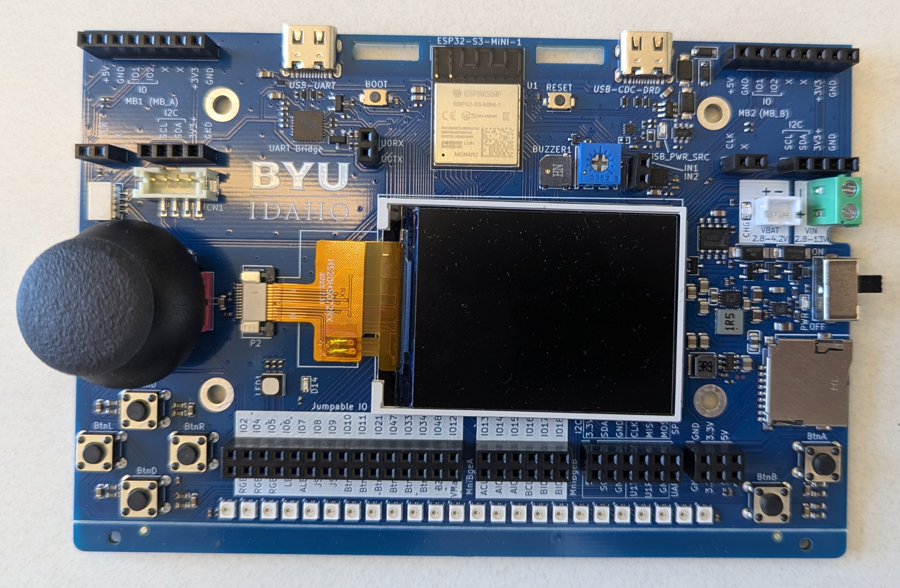
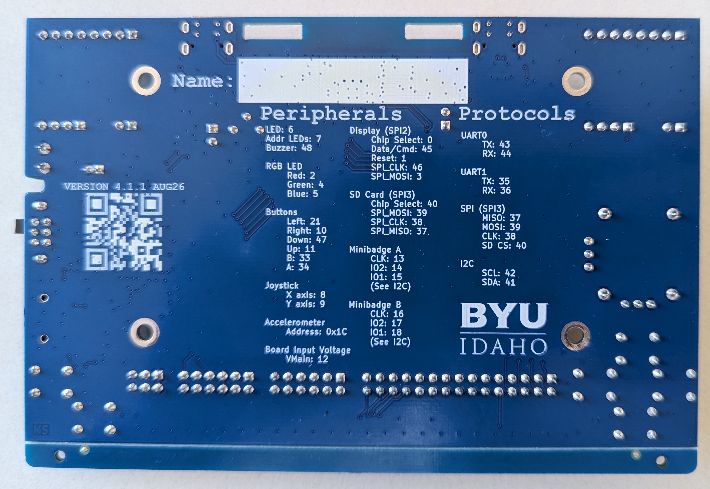

# eBadge hardware specification: V4.1.1 target

## Scope and evidence

This document is the merged hardware reference for the `pybadge.py` interface and targets board revision V4.1.1. It combines the archived MicroPython samples, the new [board_info_v4_1.md](board_info_v4_1.md) notes, and the upstream V4.1.1 CAD/BOM/netlist under `board/hardware v4.1.1/badge-esp32-s3/` (the upstream directory name contains spaces). Arduino setup instructions remain in `board_info_v4_1.md`; this file focuses on board facts and implications for the beginner-facing Python API.

The V4.1.1 [front](../byui-ebadge-front-4_1_1.jpg) and [back](../byui-ebadge-back-4_1_1.jpg) photos show the physical board and its silkscreen pin reference. Use these for revision-specific visual details; the older [V4.0 photo](../byui-ebadge-4_0.jpg) remains a legacy reference.

## Board overview

- **Controller:** ESP32-S3 module (visible module marking in the photograph; the V4 sample targets ESP32-S3 MicroPython).
- **Display:** color TFT, driven by an ST7789 controller over SPI. The sample configures a 320 × 240 pixel logical display.
- **Inputs:** two action buttons (A and B), four directional buttons, and an analog two-axis joystick.
- **Outputs:** one single-color LED, one RGB LED, an audible buzzer, and a ring/strip of 24 addressable LEDs.
- **Motion sensing:** the input lesson probes an MMA8451/MMA8452-compatible accelerometer over I²C at address `0x1C`.
- **Wireless:** ESP32-S3 Wi-Fi is used by the Wi-Fi scan sample. Bluetooth Low Energy scanning is demonstrated conditionally; availability depends on the installed MicroPython firmware and its `bluetooth` module/API.
- **Storage:** onboard microSD socket on SPI3, with its V4.1.1 pin mapping listed below. MicroPython mount support still needs validation.
- **USB:** USB-UART for programming/serial and a native USB-C dual-role port capable of USB host in the Arduino examples. USB host support is not demonstrated by the archived MicroPython examples.
- **Power:** USB, 1-cell LiPo (`Vbat`), or external `Vin` feed a power mux; the jumperable `BATTERYVOLTAGE`/`VMain` signal senses the selected `PWR_RAW` rail through a resistor divider.
- **Expansion:** exposed headers provide GPIO and power connections. The example `ebadge.py` allows GPIO 13–18 for external use and cautions that logic must not exceed 3.3 V.

## Pin assignments from current V4 software sample

The following table reflects `old/python/board_v4.py` and `ebadge.py`; verify all rows against the V4.1.1 board design before relying on them for new hardware documentation. The upstream [`board/docs/Pinout.md`](../board/docs/Pinout.md) is explicitly a V3.0 pinout and must not be used as the V4.1.1 pin map.

| Function | ESP32-S3 GPIO | Details |
| --- | ---: | --- |
| TFT SPI clock (SCLK) | 46 | SPI bus 1 in the sample |
| TFT SPI data out (MOSI) | 3 | SPI bus 1 |
| TFT SPI data in (MISO) | 12 | SPI bus 1 |
| TFT reset | 1 | Output |
| TFT chip select (CS) | 0 | Output |
| TFT data/command (DC) | 45 | Output |
| Up button | 11 | Active-high in the sample |
| Down button | 47 | Active-high in the sample |
| Left button | 21 | Active-high in the sample |
| Right button | 10 | Active-high in the sample |
| B button | 33 | Active-high in the sample |
| A button | 34 | Active-high in the sample |
| Joystick X | 8 | ADC; sample returns raw readings |
| Joystick Y | 9 | ADC; sample returns raw readings |
| RGB LED red channel | 2 | PWM |
| RGB LED green channel | 4 | PWM |
| RGB LED blue channel | 5 | PWM |
| Buzzer | 48 | PWM |
| Addressable LED data | 7 | Sample configures 24 LEDs |
| Battery / power sense | `BATTERYVOLTAGE` net; jumper to GPIO12 for the archived V4.1 software path | ADC through 150 kΩ / 10 kΩ divider from `PWR_RAW`; requires calibration |
| Accelerometer SDA | 41 | I²C bus 0, 400 kHz in sample |
| Accelerometer SCL | 42 | I²C bus 0, 400 kHz in sample |
| External helper GPIOs | 13–18 | Accepted by `ebadge.configure_pin`; intended for exposed headers |

The V4.1.1 production netlist confirms GPIO13 through GPIO18 are available at
J9 odd-numbered contacts 1, 3, 5, 7, 9, and 11. The board silk labels these
signals `IO13` through `IO18`. These names mean the ESP32 GPIO signals; they
are not ESP32 module package lead numbers. The V4.1.1 U1 BOM row has a
description/part-number mismatch: its value field says `ESP32-S2-MINI-1`, but
its manufacturer part number is `ESP32-S3-MINI-1-N4R2`, consistent with the
design folder and code samples. Use the actual GPIO signal names in software.

The board uses jumper links to route device signals to GPIO header pins. The
software helpers assume the standard links described by the board samples and
the board notes. Removing or moving a link can disconnect a peripheral or
change which GPIO it uses; software cannot detect that physical change. A
custom wiring profile will be needed when users change links.

**GPIO 12 and battery sense:** The V4 MicroPython driver assigns GPIO12 as TFT MISO, while the V4.1.1 display schematic does not require a MISO connection for normal writes. The V4.1.1 production netlist shows GPIO12 at the GPIO header separately from `BATTERYVOLTAGE`; the battery sense node is a distinct jumperable signal. `board_info_v4_1.md` describes linking `VMain` to `IO12`. Treat this as a selectable jumper route, not a permanently shared net, and do not use display reads and battery measurement simultaneously if both are routed to GPIO12.

**SD card:** The V4.1.1 netlist confirms the onboard card socket uses GPIO37 (MISO), GPIO38 (clock), GPIO39 (MOSI), and GPIO40 (chip select). These signals are board-wired; GPIO40 is not available as an external chip-select. The archived MicroPython code only has generic SD initialization and does not demonstrate a verified V4.1.1 mount workflow, so SD is a hardware capability but still requires firmware/API validation before adding a public `pybadge.py` helper.

## Physical layout and silkscreen (V4.1.1 photos)

The photographs below show the V4.1.1 board with the USB connectors at the top
and the control buttons along the bottom. The front photo shows component
placement; the back photo prints a compact pin and bus reference directly on
the blue PCB.

On the **front**:

- The landscape TFT display is near the center, slightly right of center.
- The joystick is immediately to the left of the display.
- The four directional buttons are below and to the left of the joystick. Their
  nearby labels are `BtnU`, `BtnL`, `BtnD`, and `BtnR`.
- The A and B action buttons sit along the lower-right edge, to the right of
  the screen (`BtnA` and `BtnB`).
- The row of 24 addressable LEDs runs along the lower edge of the board.
- USB-UART and USB-CDC-DRD connectors are along the top edge, on either side of
  the ESP32-S3 module. The microSD socket, power inputs, and power switch are on
  the right side in this orientation.
- Expansion sockets/headers are visible near both upper corners and in rows
  below the display. They expose GPIO, MiniBadge, I²C, SPI, power, and ground
  signals. The back silkscreen labels the interfaces; consult the tables above
  for the standard GPIO assignments.
- BYU-Idaho branding is printed permanently on the blue PCB. It is board
  artwork, separate from content drawn on the display.

The **back** silkscreen identifies the board as `VERSION 4.1.1 AUG26` and
provides quick references for peripherals, button GPIOs, joystick axes, the
accelerometer address, display SPI2, SD SPI3, UART0/UART1, I²C, MiniBadge A/B,
and `VMain: 12`. It also carries a permanent BYU-Idaho logo. The GPIO numbers
printed on the PCB are ESP32 GPIO signal numbers; for example, the header
labels `IO13`–`IO18` refer to GPIO13–GPIO18, not module package lead numbers.

The photos confirm physical placement and visible labels. Use the V4.1.1
schematic and production netlist for electrical connectivity and jumper routing.

## Capabilities and software implications

| Capability | Evidence / behavior to support |
| --- | --- |
| Buttons | Six digital inputs: A, B, up, down, left, right. Existing sample reports pressed when the GPIO reads high. |
| Joystick | Two analog axes, exposed in the sample as raw `(x, y)` ADC counts. A beginner API may add direction/center interpretation only after calibration behavior is verified. |
| Display | ST7789 TFT; 320 × 240 logical pixels in the current sample. Text and basic drawing are available through the driver. |
| RGB LED | Three PWM channels; support named colors and/or RGB values through a friendly helper. |
| Addressable LEDs | 24 LEDs on a serial data line. The sample exposes a color palette and single-pixel/ring operations. |
| Buzzer | PWM tone output with frequency in hertz and duration in milliseconds. |
| Accelerometer | I²C sensor check for MMA8451/MMA8452 ID at `0x1C`; sample reports acceleration in g when recognized. |
| Battery / power monitor | V4.1.1 has a jumperable `BATTERYVOLTAGE`/`VMain` sense net across a 150 kΩ / 10 kΩ divider from `PWR_RAW`. The archived MicroPython sample estimates voltage but uses an assumed ADC scale; calibrate before promising accurate volts. This is selected rail voltage, not charge percentage. |
| Wi-Fi | ESP32-S3 MicroPython `network.WLAN` station interface is used for scanning and connecting. Firmware and regional radio rules may affect operation. |
| Bluetooth LE | Archived MicroPython sample attempts `bluetooth.BLE` and `gap_scan`; availability and exact API support depend on the installed firmware build. |
| External GPIO | GPIO 13–18 are accepted by the sample helper for exposed external connections; use 3.3 V logic and confirm header wiring before connecting hardware. Archived servo demo uses GPIO13 at 50 Hz. |
| SD storage | Hardware wiring is confirmed at GPIO37–40. The archived examples do not establish a V4.1.1 MicroPython SD mount workflow, so it remains outside the current API until tested on the target firmware. |

### Additional V4.1.1 capabilities and API candidates

The new board notes and archived code reveal several useful capabilities beyond
the first `pybadge.py` API scope:

- **Battery/power measurement:** `BATTERYVOLTAGE` is a separate jumperable
  signal. The V4.1.1 design notes identify a 150 kΩ / 10 kΩ divider from
  `PWR_RAW`, giving an ideal scale factor of 16 from ADC-pin volts to the
  selected input rail. This measures the power mux output (USB, Vbat, or Vin),
  not necessarily battery-only voltage. The archived `vmain` script uses a
  rough 2.0 V ADC full-scale assumption; the Arduino board notes recommend a
  nominal 1.1 V value with per-chip calibration. Neither is a measured
  calibration. Keep `read_battery_voltage()` unavailable or clearly mark it
  uncalibrated until hardware measurements settle the ADC conversion.
- **SD card:** hardware wiring is now identified above. A future API could
  expose simple file operations or mount/unmount helpers, but only after the
  selected MicroPython firmware's SD/SPI support and safe mount behavior are
  verified. Avoid returning low-level `machine.SPI` objects to beginners.
- **BLE:** the archived wireless sample conditionally uses MicroPython's
  `bluetooth.BLE` and `gap_scan`; board_info also describes Arduino BLE. This
  confirms radio hardware capability, not that every MicroPython build includes
  a working BLE stack. A future API could offer a beginner-friendly scan first,
  behind a capability check. The sample scans advertisements and returns unique
  device addresses with strongest RSSI; it does not decode advertised names.
- **USB host:** the native USB-C port has dual-role hardware, and the added
  Arduino notes include keyboard/mouse host demos. The archived examples mark
  USB host as Arduino-only. Do not promise it from `pybadge.py` until the target
  MicroPython build and host library support it.
- **Expansion:** GPIO13–GPIO18 can support PWM, digital I/O, ADC where the MCU
  and board routing permit, and external actuators such as servos. Existing
  Arduino notes include servo and stepper examples; the latter needs an
  external driver. A future beginner API may include servo angle control, but
  should explain the separate power and ground requirements.
- **Display drawing:** archived examples use the ST7789 driver's pixel, line,
  rectangle, polygon, bitmap, and text operations. The first public API can
  remain simple, but a small set of drawing helpers (pixel, line, filled
  rectangle, and image) would enable games and visual projects without exposing
  the driver object.
- **Animation/audio:** archived examples include a BYU-I demo with a changing
  LED pattern, plus a buzzer song. These support the reviewed loop-and-pause
  approach for animation; a later `play_song()` helper could be considered if
  students need nonblocking notes or note sequences.
- **Serial communication:** the design exposes UART0 through the USB-UART
  bridge and UART1 on GPIO35/36. A small serial helper may be useful for
  accessory projects, but it is lower priority than core board features.
- **Accelerometer events:** the MMA8452Q interrupt outputs are available at an
  unlabelled two-pin header near the sensor. A future interrupt/event helper
  could support tap, shake, or free-fall detection after a user connects an
  interrupt line to a free GPIO; ordinary accelerometer reads need no such
  jumper.

## Source files to verify during board setup

- `board/hardware v4.1.1/badge-esp32-s3/`: authoritative target-revision layout and schematics in the upstream e-badge repository. The upstream directory name contains spaces.
- `board/hardware v4.1.1/badge-esp32-s3/production/bom.csv`: revision-specific component list. It confirms 24 SK6805 addressable LEDs and an MMA8452 accelerometer.
- `board/hardware v4.1.1/badge-esp32-s3/production/netlist.ipc`: physical V4.1.1 net assignments, including the SD socket, GPIO header, accelerometer, and battery-sense nets.
- [`board_info_v4_1.md`](board_info_v4_1.md): broader Arduino IDE guide and V4.1 feature notes; use this hardware spec for the consolidated `pybadge.py`-oriented reference.
- `old/code_for_board_v4_1/code_for_board_v4_1/vmain/vmain.py`: V4.1 MicroPython battery/power-sense example; its ADC voltage scale is an estimate and needs calibration.
- `old/code_for_board_v4_1/code_for_board_v4_1/servo/servo.py`: GPIO13 PWM servo sweep example.
- `old/code_for_board_v4_1/code_for_board_v4_1/serial/serial.py`: USB-UART stdin/stdout echo example.
- `old/code_for_board_v4_1/code_for_board_v4_1/wireless/demo_wireless_scan.py`: Wi-Fi scan plus optional BLE advertisement scan example.
- `board/docs/feature-requirements.md`: general eBadge feature list. It is not revision-specific.
- `board/docs/Pinout.md`: labels itself V3.0; do not use it as the V4.1.1 pin map.
- `old/python/board_v4.py`: display, button, joystick, RGB LED, buzzer, and addressable LED mapping used by the current sample.
- `old/python/ebadge.py`: accelerometer, battery ADC, Wi-Fi/BLE, exposed GPIO, and generic SD helper behavior.
- `old/python/demo_wireless_scan.py`: demonstrated Wi-Fi scan and conditional BLE scan behavior.
- `old/code_for_board_v4_1/code_for_board_v4_1/`: archived V4.1 MicroPython examples. These are reference examples and are intentionally exempt from the repository's Python style requirements.
- `byui-ebadge-4_0.jpg`: visual guide to physical control and header placement; V4.0-named image, not authoritative for V4.1.1 differences.
